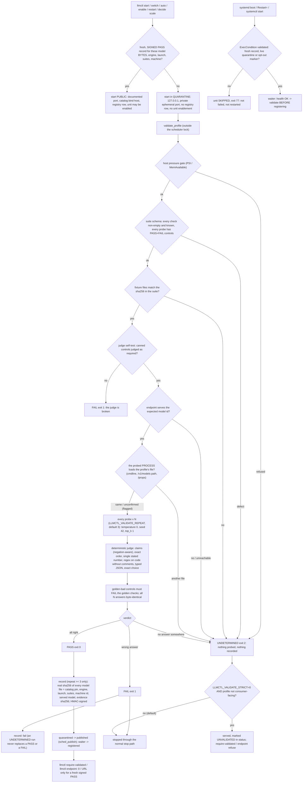

# Validation & Verification contract

This project follows an anti-bluff methodology: **every claim about behavior
is backed by a command, its exit code, and its raw output** — captured either
in the test harness output or in per-profile evidence logs.

## The test harness

`tests/run_tests.sh` (invoked by `make test`):

1. Discovers `tests/test_*.sh`.
2. For each test file, prints the exact command (`bash <path>`), runs it as a
   real subprocess, captures the exit code and the full raw output, and prints
   both.
3. Builds the summary table **from the actual exit codes** and exits non-zero
   if any test failed.

Nothing is mocked at the harness level. Determinism on arbitrary machines is
achieved with explicit seams:

* `LLMCTL_FAKE_HW=<fixture.json>` — the hardware probe returns the fixture
  verbatim (after a JSON validity check). Fixtures:
  `tests/fixtures/hw-baseline.json` (Ryzen 7 2700X / 32 GB / RTX 3060 12 GB /
  NVMe), `hw-workstation.json` (Threadripper 64-core / 256 GB / 32 GB VRAM),
  `hw-apple.json` (M4 Max / 64 GB unified), `hw-constrained.json` (8 GB VRAM
  variant used to exercise eviction protection).
* `LLMCTL_DRY_RUN=1` — service actions (`systemctl`, `launchctl`,
  `loginctl`) are printed instead of executed. State files (reservations,
  env files, unit/plist generation) are still real.
* `LLMCTL_HF_BASE=<url>` — the download test serves its fixture from a local
  `python3 -m http.server` instead of Hugging Face, exercising the real
  curl/verify/rename code path, including sha256-mismatch rejection.
* All state dirs are relocatable (`LLMCTL_STATE_DIR` etc.) so tests run fully
  isolated in a `mktemp` directory.

Covered by the harness:

| Area | Test |
|---|---|
| `bash -n` of every shipped script, shebang + strict mode | `test_syntax.sh` |
| catalog JSON validity, unique ports, required fields, real sha256s | `test_catalog_json.sh` |
| probe runs on the host, valid JSON, fixture override, failure paths | `test_hardware_probe.sh` |
| planner tiers, footprints, recommended sets, co-residency groups (exact values, 3 fixtures) | `test_planner.sh` |
| download + verify + skip + mismatch rejection + evidence log | `test_download.sh` |
| scheduler start/refuse/evict/protect/switch (dry-run) | `test_scheduler.sh` |
| systemd unit + launchd plist contents, memory limits from probe | `test_services.sh` |
| CLI help/version/exit codes/unknown command | `test_cli.sh` |

Decision layer (3.1.0), also run by `make test`:

| Area | Test |
|---|---|
| HTTPS gateway, every row of the endpoint inventory, key/401 paths, `--stop` identity checks | `test_gateway_endpoints.sh`, `test_gateway_mutation.sh` |
| `llmctl decide` shell front end against a real TLS gateway | `test_decide_cli.sh`, `test_decide.sh` |
| Go unit tests of every `internal/*` package and `cmd/llmctl-decide` | `test_go_unit.sh` |
| certificates and keys (CLI behaviour, mutations that must be caught) | `test_certs_go_cli.sh`, `test_certs_go_mutation.sh`, `test_keyring_go_cli.sh`, `test_apikey_lifecycle.sh` |
| registry, dynamic ports, discovery | `test_registry_cli.sh`, `test_registry_discovery.sh`, `test_dynamic_ports.sh` |
| the 66 defects of the first-candidate register stay fixed | `test_regression_defects.sh` (map: `specs/009-jev-decision-models/evidence/red-to-green-map.json`) |
| no literal keys in docs/templates; no retired variables; no stray binaries; no secrets in release archives | `test_docs_no_literal_keys.sh`, `test_no_retired_vars.sh`, `test_no_stray_binaries.sh`, `test_release_no_secrets.sh` |
| every doc reachable from the README | `test_doc_reachability.sh` |
| no shipped doc or help text calls the enforced validation gate advisory | `test_docs_gate_not_advisory.sh` |
| rootless vantage container | `test_vantage.sh`, `test_vantage_classifier.sh` (SKIP with a reason when podman or an image is missing) |

Per-suite assertion counts are measured by `scripts/doc_counts.sh`, not typed (see `docs/scripts/doc_counts.md`). A suite that cannot run on
the host prints `SKIP-SUITE: <reason>` and is reported as SKIP, never PASS. Gate honesty: a decision-model *accuracy* figure comes only from the
golden-set runner against a real model ([golden-set](golden-set.md)); none is published yet, and when one is it ships labelled
*provisional - labels agent-authored, human review pending*. What the 3.1.0 work did not verify live: [limitations](limitations.md).

## Release gate status for 3.1.0

* **Manual QA waived by the operator, 2026-10-08; the constitution gate is operator-waived, not satisfied.** The project's constitution (section 11.4.185) makes live manual QA by a person the final gate before a tag. For 3.1.0 the operator waived it, so the release rests on the
  automated gates listed on this page, the independent code reviews and the full test suite only. This is a recorded waiver, not a passed gate; nothing on this page should be read as evidence that a person exercised the release.
* **Platforms.** Linux is the live-verified platform. macOS is shipped labelled **verified statically only** (launchd, plist and bash 3.2 behaviour were read and fixture-tested, never run on a Mac). Windows is unsupported.
* **Second host.** The second-machine runs used `nezha.local` (ALT Linux, CPU only).
* **Accuracy figures** are provisional: agent-authored labels, human review pending. Per-profile-and-type `experimental` labels (profiles whose measured Wilson lower bound does not clear the baseline) are the shipped policy and are not yet visible in the CLI output; they land with the maturity task, see [limitations](limitations.md#release-status-of-310).

## Model validation gate

Contract (operator mandate 2026-10-12, enforced since the 2026-10-14 fix round): **every model llmctl runs must pass a deterministic known-answer
suite BEFORE any project, component, service or submodule uses it**; wrong answers are real defects. This is the *model* gate; the harness above
verifies *llmctl*. Implementation: `lib/validate.sh` (front end, state, policy, hooks), `lib/validate_judge.py` (runner, judge, records, stdlib
only), the quarantine half of `lib/scheduler.sh` and the unit gate of `lib/svc_hook.sh`. Suites live in `validation/suites/<name>/`; the catalog
names each profile's suites in `validation.suites` (every shipped profile names at least one).

**Status of the evidence (read this first).** Real-model runs exist only from BEFORE this fix round: profile `vision` on this host, 2026-10-13
([vision-live-2026-10-13](qa/vision-live-2026-10-13/README.md)) and 2026-10-14 ([vision-live-2026-10-14](qa/vision-live-2026-10-14/README.md));
`small` (chat-v1) on this host ([small-live-2026-10-14](qa/small-live-2026-10-14/README.md)); and a `--host` run against a capped server on the
second host ([vision-live-nezha-2026-10-14](qa/vision-live-nezha-2026-10-14/README.md), evidence only, no record). They used the earlier judge
(one determinism repeat, no signed records), and every suite file changed since (new canned controls), so **no profile has a current validation
record: every profile is NOT VALIDATED until it is validated again** (`llmctl validate-all` lists them). The 26 real answers those runs captured
are kept as a regression fixture (`tests/fixtures/validation/recorded_live_answers.json`): the current judge gives every one of them the same
verdict. **Never run against a real model: the colibri profiles and every decide-* profile** (`validation.executed: false` in the catalog,
`execution_status: unexecuted` in `decide-v1`); their suites are proven against fixtures only and their live behaviour is UNCONFIRMED.

### Flow

### Commands and exit codes

| Command | Meaning |
|---|---|
| `llmctl validate <profile> [--host URL] [--json] [--keep]` | run every suite of the profile; a profile that is not running is started UNPUBLISHED (quarantine) and stopped again unless `--keep` (which then says it keeps running) |
| `llmctl vision validate [--profile vision\|vision-pro] ...` | the golden-screenshot suite only |
| `llmctl validate-all` | every running profile, then a coverage list of EVERY catalog profile: a signed, unexpired PASS record, or `NOT VALIDATED - <reason>` (never-executed suites say so) |
| `llmctl require-validated <profile>` | exit 0 only for a fresh, signed PASS record that matches what would run now (below); 1 not validated; 2 cannot determine (e.g. `LLMCTL_VALIDATION_MAX_AGE=nan`) |
| `llmctl endpoint <profile>` | prints `http://127.0.0.1:<port>` ONLY for a running, published, validated profile; exit 1 with the reason otherwise - **the call a consuming project makes** |
| `llmctl models verify <profile> [--live]` | checksums, then the suite gate (with `--live`, or when running, the suite is run) |
| `llmctl models pins` | supply-chain gate: every UNPINNED revision / file sha256 of the catalog; exit 1 while any remains |

`0` every check passed; `1` any wrong result (never excused, no threshold is loosened); `2` could not determine (not downloaded, not served,
endpoint down, wrong model or file served, truncated or reasoning-only completion, suite defect, pressure refusal, quick mode for a local profile).
`1` outranks `2`. UNDETERMINED is never PASS.

### Suites and the judge

`chat-v1`, `coder-v1` (text prompt to answer), `vision-golden-v1` (golden screenshots with known content plus two golden-bad control images that must
fail the golden checks), `embedding-v1` (cosine ordering plus byte-stable repeated embeddings), `decide-v1` (typed choice questions, below).
Sampling is deterministic (temperature 0, fixed seed, top_k 1, no prompt cache). The judge is plain code, never an LLM. Rules (2026-10-14 review,
finding 7 - every one has a canned FAIL control in the suites, so the self-test proves it before every real run):

* **A claim must be asserted.** `contains_all` / `contains_any` / `forbidden` count a needle only when an occurrence is NOT negated: a negation word
  (`no`, `not`, `none`, `never`, `without`, `cannot`, `n't` ...) within the 4 words before it, in the same clause (clauses end at a newline, `!`,
  `?`, `;`, `:` and a `.` that is not a decimal point). `There is no ORANGE TIGER 42 here` does not claim the text; `No problem. ORANGE TIGER 42`
  does; `OSLO (not PARIS)` does not claim PARIS. Trade-off: an answer that negates something just before stating the right value in the same
  clause FAILs - the prompts ask for the value only.
* **One stated number.** `number_equals` needs the answer to state ONE number: after the last `=` that is followed by a number when the answer
  restates an equation (the operands before it are not answers), else anywhere in the answer. Every number stated after that point must have the
  same value: `3 or 4`, `I count 3... no, 4`, `three or four`, `17 + 25 = 42, or maybe 43`, `9 is larger than 4` FAIL; `There are three red
  circles.`, `17 + 25 = 42. The answer is 42.` PASS. Digits with an optional `.` fraction or a number word `zero`..`twenty` (not inside
  `twenty-two`); `10,000` and `.42` are not numbers. **Trade-offs, stated plainly:** `41 because 17+25=42` PASSES (the numbers before the
  last `=` are operands) and `42 = 17+25` FAILS (after the `=` it states 17 and 25); the rule is mechanical, the prompts ask for the number only.
* **Exact order.** `ordered` takes every occurrence of every listed item in answer order; that sequence must BE the list: `Red, green, blue, red`
  is not RED GREEN BLUE, an item read twice or missing FAILs.
* **Comments are not code.** A probe with `code_language: python` is judged on the code of the answer (the fenced blocks when there are any) with
  every comment removed (`tokenize`; a `#` inside a string is not a comment): `return a - b  # not: return a + b` is a subtraction.
* **Typed JSON.** `json_subset` compares JSON values by type: `1` is not `true`, `0` is not `false`, `"1"` is not `1` (`1.0` is `1`).
* **No vacuous check.** Empty or unknown checks (`{}`, `contains_all: []`, an uncompilable regex, an item without letters or digits), a probe
  without a prompt, or a probe without at least one canned PASS **and** one canned FAIL judge control are a **suite defect**: the run is
  UNDETERMINED before any request and `selftest` exits 1.
* **N repeats (Constitution 11.4.50).** Every judged probe is asked `LLMCTL_VALIDATE_REPEAT` times (default **3**); all answers must be
  byte-identical (decide: the choice AND the probabilities). `LLMCTL_VALIDATE_REPEAT=1` is the documented **quick mode**: only the suite's
  `determinism_repeat` probes are asked once more, the run says `quick mode`, and it is **never recorded** (a local quick PASS exits 2: not validated).
* **Complete answers only:** a completion cut off by the token budget (`finish_reason=length`) with reasoning content, or empty `message.content`
  while the reasoning channel is non-empty, is UNDETERMINED with a hint to raise `request.max_tokens`. A truncated WRONG answer is a FAIL; a
  truncated answer that would pass is still UNDETERMINED. Only `message.content` is judged.

**decide-v1** (finding 2): five typed choice questions whose answer is defensible BY CONSTRUCTION (the state or the option text states it; the right
option is first in two questions and second in three, so an always-A model fails; `invoice_team` is the exact question of the post-download
decision smoke). They are asked through the PRODUCTION Go driver of the profile's protocol (`llmctl-decide smoke --question-file F`; letter-logit,
nli-onnx, systemone-native) and judged by exact `choice_equals`. A local decide run identifies the model by the probed process's model file (a
decide engine has no unauthenticated `/v1/models`): unconfirmed is UNDETERMINED. `decide-tiny` (protocol jev-verdict) has no driver: UNDETERMINED by
design. **colibri** reports its family's `default_model_id`, not a file name: the catalog names it in `validation.expect_model_id`
(`qwen3.6-colibri`, `glm-5.2-colibri`; source lines in the catalog entry; the qwen36 one cross-checked against the downloaded `config.json`),
and a colibri server is expected to load the profile directory.

### Records (what `require-validated` checks)

`$LLMCTL_STATE_DIR/validation/<profile>.json` (0600, directory 0700) is written only by `llmctl validate` and holds: status; the **real sha256 of
every model file** with its size; the catalog pins; engine tag; launch fingerprint (exec + arguments minus `--host`/`--port`); per-suite content
hash; host id; the model file of the probed process (`served_model`: path, size, mtime, sources, confirmed); `repeat`; the path and **sha256 of
this run's own evidence file**; timestamp; and an **HMAC-SHA256 signature** under `$LLMCTL_STATE_DIR/validation/.hmac.key` (0600, created on first
use). `require-validated` exits 0 only when the signature verifies, the status is pass, every file hashes to what was recorded AND to its catalog
pin, engine/launch/suites/host id match, `repeat >= 3`, the evidence file still hashes to the recorded value, and the record is younger than
`LLMCTL_VALIDATION_MAX_AGE` (whole seconds >= 0, default 604800; `nan`, `inf`, negative or exponent forms exit 2) and not from the future.

* **Hashing.** Model files are hashed by streaming sha256; the result is cached in `.hashcache.json` (0600) keyed by size, mtime_ns,
  **ctime_ns**, inode and device, each entry HMAC'd - any write changes ctime, so different bytes with a restored size and mtime are re-hashed and
  refused. Fast path: a cache hit; at record creation every file whose hash came from the cache is hashed again once (the catalog pin is verified
  once per record creation). A file whose bytes do not match its catalog pin is never recorded as PASS (exit 2). On a 380 GB profile the first
  key computation and the record step each read the files once.
* **Host identity.** `host_id` = sha256 of a fixed prefix and `/etc/machine-id` (fallback `/var/lib/dbus/machine-id`; last resort the hostname,
  `host_id_source: hostname`, weaker). The raw machine id is never written; the hostname is informational only - a spoofed hostname changes nothing.
* **Same-user limit (stated plainly).** The signature stops accidental edits, copied state and hand-written records. A malicious process running
  as the SAME user can read the key and forge a record; that is out of scope for a file-based gate.
* **Verdict precedence.** A FAIL replaces anything; an UNDETERMINED run never replaces a PASS or a FAIL record (it writes an `undetermined`
  record only when there is none); a quick-mode run is never recorded; a `--host` run is evidence only.

### Enforcement (strict by default)

The gate is no longer advisory - and since 2026-10-14 not even UNDETERMINED is served.
A profile is **served** - its documented port, its catalog bind host, a registry row (the decision gateway resolves backends from the registry),
an enabled unit - only with a fresh, signed PASS record for what would run. Otherwise:

| Path | What happens |
|---|---|
| `start`, `switch`, `auto` (all through `_sched_start_impl`) | started in **QUARANTINE**: `--host 127.0.0.1` on a private ephemeral port, no registry row, `quarantine=1` in the reservation, `LLMCTL_QUARANTINE_UNTIL` in the env record; `validate_after_start` validates it; PASS -> `sched_publish` stops it and starts it published; FAIL/UNDETERMINED -> stopped, exit non-zero. A `switch` whose target fails brings the previous set back through the same gate |
| `enable` | validated (in quarantine) BEFORE any unit is enabled; FAIL/UNDETERMINED -> nothing enabled |
| `restart` | with a fresh record: `systemctl restart`; without: stopped, started in quarantine, validated, published or stopped - never restarted in place on its public port |
| `decide scale` | adding instances needs a fresh record of the base profile (validate it first); scaling down is never blocked |
| systemd unit (boot, `Restart=`, `systemctl start`) | `ExecCondition=svc_hook.sh validated %i`: skipped with exit 77 (not failed, not restarted) without a fresh record; a live quarantine start and an opt-out marker pass. The registration waiter validates BEFORE it registers and stops the unit on FAIL/UNDETERMINED; a quarantine unit is never registered |
| `status` / `status --json` | a `validation:` line / field per running profile: `validated`, `QUARANTINE (...)`, `UNVALIDATED (<opt-out>)`, `NOT VALIDATED (<reason>)`; opt-outs in effect are printed as WARN lines |
| `endpoint`, `require-validated` | refuse everything but a running, published, validated profile |
| llmctld model routes | dispatch to `bin/llmctl start/stop/status`, so the same gate applies |

| Verdict | Effect |
|---|---|
| PASS (0) | published (quarantine) / keeps serving; the signed record is written |
| FAIL (1) | stopped through the normal stop path (`sched_stop` -> `svc_stop`; systemd: `systemctl --user stop <unit>`), reservation removed, exit non-zero |
| UNDETERMINED (2) | **stopped as well** (strict is the default): an unvalidated model is never served. Opt-out below |

**Opt-outs (documented, loud, never for consumer-facing profiles).** `LLMCTL_VALIDATE_STRICT=0` serves an UNDETERMINED profile marked UNVALIDATED
(reservation `unvalidated=...`, env record `LLMCTL_UNVALIDATED=...` for the unit gate, a WARN line in `status`) - **refused** for a profile whose
catalog `validation.consumer_facing` is not `false` (the default is consumer-facing; every shipped profile is). `LLMCTL_VALIDATE_ON_START=0`
(no validation at start) is refused for consumer-facing profiles too, except inside the test harness (`LLMCTL_VALIDATE_HERMETIC=1`, set by
`tests/helpers.sh`). `LLMCTL_DRY_RUN=1` starts nothing and validates nothing.

**Costs, stated plainly.** The first start of a profile without a record loads the model twice (quarantine, then published); later starts with a
fresh record load it once. Already-installed units keep their old template until `llmctl install` - after it, a unit whose profile has no fresh
record (today: every profile, see "Status of the evidence") is skipped at its next boot or restart until it is validated: run
`llmctl start <profile>` (which validates first) for each profile you serve. The decide-* profiles cannot be validated on a host without a working
`llmctl-decide` that has `--question-file` (rebuild: `llmctl build decide`) and `decide-tiny` cannot be validated at all yet.

### Operational safety

* `validate_profile` has ONE stop path for a profile it started (`_val_cleanup_started`): every return after the start (no port reservation, key
  failure, pressure refusal) stops it unless `--keep`, which says it keeps running. SIGINT/SIGTERM/SIGHUP remove the temp files, kill the judge child
  by PID (never by process group) and stop such a profile; exit status 130/143/129.
* **Host-pressure gate** (`hw_pressure_gate`, lib/hardware.sh): before the validator's own start (footprint included; message "nothing was
  started or probed") and again before the probe loop (PSI only; message "the probes were NOT sent" - the profile may already be up and is then
  stopped by the cleanup path). Thresholds: PSI memory `full avg10 > 2`, `some avg10 > 10`, `MemAvailable < footprint + 4096 MiB`. A refusal is
  UNDETERMINED (exit 2), never a FAIL.
* **RAM budget (finding 10, Constitution 12.6).** Admission uses the tighter of `MemAvailable - 4 GiB` and **60% of MemTotal minus the RAM the
  running llmctl profiles reserve** (`llmctl plan --json` shows `ram_cap_mb`, `ram_reserved_mb`, `ram_avail_budget_mb`); `LLMCTL_RAM_CAP_PCT` may
  lower the cap, never raise it.
* `LLMCTL_VALIDATE_API_KEY` is sent only to loopback hosts or hosts listed exactly in `LLMCTL_VALIDATE_API_KEY_HOSTS`; redirects are never
  followed; proxies are ignored; only `http`/`https`; a response is limited to 8 MiB; every request has a wall-clock deadline
  (`LLMCTL_VALIDATE_TIMEOUT`, finite and > 0); evidence and records are 0600 with userinfo, query and fragment removed from logged URLs.
* **Suites directory.** `LLMCTL_VALIDATION_SUITES_DIR` (and the test-only `LLMCTL_MACHINE_ID_FILE` / `LLMCTL_TEST_HOSTNAME`) are honoured only
  with `LLMCTL_VALIDATE_HERMETIC=1`.
* Exit-code contract: exit 1 means exactly "the judge printed `VERDICT: FAIL`"; a crash, `die()` or `set -e` failure is UNDETERMINED (which strict
  mode also stops). Only HTTP 400/422 count as FAIL. The systemd waiter treats only the private FAIL code 64 as a wrong answer and removes the
  reservation before `systemctl --user stop`.
* Concurrency: the CLI hook and the waiter serialise on `<runtime>/.validate-<profile>.lock` (`LLMCTL_VALIDATE_LOCK_WAIT`, default 900 s).
* **The registration waiter needs the port registry.** The systemd-path validation runs in the waiter that `hk_register` spawns; it does
  nothing when there is no `MAINPID` or the port registry is inactive (`LLMCTL_PORTREG=0|off|no`, no portreg binary, `LLMCTL_DRY_RUN=1`).
  Such a unit is still gated before it starts by the `validated` ExecCondition (a fresh record is required), it is just not re-validated
  after it answers. The waiter reads the unit's environment, not your shell.

### Supply chain

`llmctl models pins` lists every profile whose `hf_revision` is not a 40-hex commit and every file without a `sha256` (exit 1 while any remains);
a download from a moving revision warns `UNPINNED`. Today: 10 revisions (`main`) and 6 colibri config files. None was pinned in this round: no
manifest, download record or evidence file names their upstream commit, and a sha256 computed from a local download would only restate what was
downloaded; `tests/fixtures/catalog_unpinned_allowlist.txt` is a ratchet - a NEW unpinned entry fails the tests. Unpinned files are still hashed
into every validation record, so a changed byte invalidates the record.

### Known limits

1. **No live run of the enforcement, the decide-v1 suite or a colibri profile** (host safety: no real profile was started or stopped in this round).
   Everything in this section is proven against fixtures (recording service manager, fixture OpenAI server, a stub of `llmctl-decide`; the real
   binary's `--question-file` contract is checked) and is UNCONFIRMED live.
2. **Served-model identity** is established from `/proc` only on Linux and only for processes of the same user; elsewhere it falls back to
   `/v1/models` / `/props` paths and is otherwise flagged UNCONFIRMED (a PASS is still recorded for an OpenAI-compatible engine; for a decide
   engine it is UNDETERMINED).
3. `test_livetest_watchdog.sh` does not finish within the 580 s bound used in this round (neither at the previous head; a duration, not a failure).

### Tests of the gate

| Area | Test |
|---|---|
| judge soundness: hedged numbers, order, negation, comments, empty checks, typed JSON, controls coverage, N=3, real recorded answers | `test_validation_judge_soundness.sh` |
| signed records, real file hashes, evidence binding, machine id, finite max age, verdict precedence, quick mode | `test_validation_record_integrity.sh` |
| the model file of the probed process | `test_validation_served_identity.sh` |
| one cleanup path, pressure-gate wording | `test_validation_cleanup.sh` |
| decide-v1, colibri ids, coverage in validate-all, the real `--question-file` | `test_validation_decide_colibri.sh` |
| enforcement: quarantine, publish, strict default, opt-outs, enable/restart/scale/switch, unit ExecCondition, waiter, endpoint, status | `test_validation_enforcement.sh` |
| unpinned gate, 60% RAM cap | `test_supply_chain_ramcap.sh` |
| mutants of the new branches, each caught | `test_validation_mutants.sh` |
| judge, controls, mutations, state/freshness, start hook against the fixture server | `test_vision_validate.sh` |
| golden fixture images and the expectation file | `test_vision_golden_fixtures.sh` |
| every suite: structure, determinism, controls, per-probe discrimination | `test_validation_suites.sh` |
| the wiring of the gate (start/switch/auto, restart/enable, systemd waiter, pressure) | `test_gate_wiring_start_paths.sh`, `test_gate_wiring_restart_enable.sh`, `test_gate_wiring_systemd_waiter.sh`, `test_gate_wiring_pressure.sh`, `test_gate_waiter_stop.sh` |
| the defect register of the first independent review | `test_validation_gate_defects.sh`, `test_validation_exit_mapping.sh`, `test_validation_http_codes.sh`, `test_validation_identity.sh`, `test_validation_lock.sh` |

## Model download verification

`llmctl models download <profile>`:

1. Skips files that exist **and** match the catalog sha256.
2. Downloads with `curl -L --continue-at -` (resumable) to `<file>.part`.
3. Verifies size **and** sha256 of the `.part` file; a mismatch is a hard
   failure and the content never reaches the final path.
4. Atomically renames into place only after verification.
5. GGUF profiles: boots the real `llama-server` (`--ctx-size 512
   --n-gpu-layers 0`), polls `/health`, sends the deterministic prompt
   "Reply with exactly: OK" at temperature 0, and requires "OK" in the
   response. Colibri profiles: `coli doctor` when installed, else a structural
   check (non-empty safetensors shards + config).
6. Appends command + exit code + output evidence to
   `~/.local/state/llmctl/verify/<profile>.log`.

Catalog checksums were captured from the Hugging Face API
(`/api/models/<repo>?blobs=true`, the `lfs.sha256` of each blob) at
generation time. Entries whose sha256 could not be captured carry
`"sha256": null` (non-LFS config files); for those the checksum is fetched
live from the same API at download time, and the download **fails hard** if it
cannot be obtained. `llmctl models pins` lists them and every moving
`hf_revision` (see "Supply chain" above).

## What is NOT covered

* **No GPU in the test sandbox.** CUDA/ROCm/Metal build paths and GPU-offload
  runtime behavior are validated by code inspection and by the planner tests
  against fixtures, not by executing on real GPUs.
* **No systemd/launchd in the sandbox.** Service lifecycle is tested via
  `LLMCTL_DRY_RUN=1`; unit/plist *contents* are asserted exactly, but the
  units were not executed under a real systemd user session here.
* **Engine compilation is not run in CI/sandbox** (no toolchain weight
  budget). `llmctl build` verifies the produced binaries with `--version`
  when actually executed on a real machine.
* **The smoke test requires a downloaded multi-GB model**; it is exercised in
  the harness only in disabled form (`LLMCTL_SMOKE=0`).
* Model quality/perplexity is out of scope; verification is integrity +
  "serves a deterministic completion", not benchmark scores.
