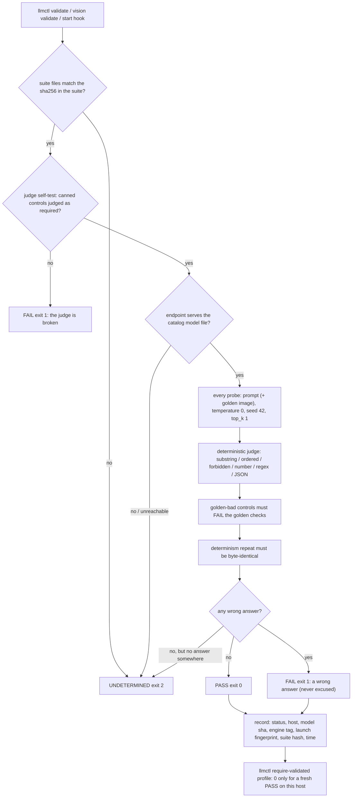

# Validation & Verification contract

This project follows an anti-bluff methodology: **every claim about behavior
is backed by a command, its exit code, and its raw output** — captured either
in the test harness output or in per-profile evidence logs.

## The test harness

`tests/run_tests.sh` (invoked by `make test`):

1. Discovers `tests/test_*.sh`.
2. For each test file, prints the exact command (`bash <path>`), runs it as a
   real subprocess, captures the exit code and the full raw output, and prints
   both.
3. Builds the summary table **from the actual exit codes** and exits non-zero
   if any test failed.

Nothing is mocked at the harness level. Determinism on arbitrary machines is
achieved with explicit seams:

* `LLMCTL_FAKE_HW=<fixture.json>` — the hardware probe returns the fixture
  verbatim (after a JSON validity check). Fixtures:
  `tests/fixtures/hw-baseline.json` (Ryzen 7 2700X / 32 GB / RTX 3060 12 GB /
  NVMe), `hw-workstation.json` (Threadripper 64-core / 256 GB / 32 GB VRAM),
  `hw-apple.json` (M4 Max / 64 GB unified), `hw-constrained.json` (8 GB VRAM
  variant used to exercise eviction protection).
* `LLMCTL_DRY_RUN=1` — service actions (`systemctl`, `launchctl`,
  `loginctl`) are printed instead of executed. State files (reservations,
  env files, unit/plist generation) are still real.
* `LLMCTL_HF_BASE=<url>` — the download test serves its fixture from a local
  `python3 -m http.server` instead of Hugging Face, exercising the real
  curl/verify/rename code path, including sha256-mismatch rejection.
* All state dirs are relocatable (`LLMCTL_STATE_DIR` etc.) so tests run fully
  isolated in a `mktemp` directory.

Covered by the harness:

| Area | Test |
|---|---|
| `bash -n` of every shipped script, shebang + strict mode | `test_syntax.sh` |
| catalog JSON validity, unique ports, required fields, real sha256s | `test_catalog_json.sh` |
| probe runs on the host, valid JSON, fixture override, failure paths | `test_hardware_probe.sh` |
| planner tiers, footprints, recommended sets, co-residency groups (exact values, 3 fixtures) | `test_planner.sh` |
| download + verify + skip + mismatch rejection + evidence log | `test_download.sh` |
| scheduler start/refuse/evict/protect/switch (dry-run) | `test_scheduler.sh` |
| systemd unit + launchd plist contents, memory limits from probe | `test_services.sh` |
| CLI help/version/exit codes/unknown command | `test_cli.sh` |

Decision layer (3.1.0), also run by `make test`:

| Area | Test |
|---|---|
| HTTPS gateway, every row of the endpoint inventory, key/401 paths, `--stop` identity checks | `test_gateway_endpoints.sh`, `test_gateway_mutation.sh` |
| `llmctl decide` shell front end against a real TLS gateway | `test_decide_cli.sh`, `test_decide.sh` |
| Go unit tests of every `internal/*` package and `cmd/llmctl-decide` | `test_go_unit.sh` |
| certificates and keys (CLI behaviour, mutations that must be caught) | `test_certs_go_cli.sh`, `test_certs_go_mutation.sh`, `test_keyring_go_cli.sh`, `test_apikey_lifecycle.sh` |
| registry, dynamic ports, discovery | `test_registry_cli.sh`, `test_registry_discovery.sh`, `test_dynamic_ports.sh` |
| the 66 defects of the first-candidate register stay fixed | `test_regression_defects.sh` (map: `specs/009-jev-decision-models/evidence/red-to-green-map.json`) |
| no literal keys in docs/templates; no retired variables; no stray binaries; no secrets in release archives | `test_docs_no_literal_keys.sh`, `test_no_retired_vars.sh`, `test_no_stray_binaries.sh`, `test_release_no_secrets.sh` |
| every doc reachable from the README | `test_doc_reachability.sh` |
| no shipped doc or help text calls the enforced validation gate advisory | `test_docs_gate_not_advisory.sh` |
| rootless vantage container | `test_vantage.sh`, `test_vantage_classifier.sh` (SKIP with a reason when podman or an image is missing) |

Per-suite assertion counts are measured by `scripts/doc_counts.sh`, not typed (see `docs/scripts/doc_counts.md`). A suite that cannot run on
the host prints `SKIP-SUITE: <reason>` and is reported as SKIP, never PASS. Gate honesty: a decision-model *accuracy* figure comes only from the
golden-set runner against a real model ([golden-set](golden-set.md)); none is published yet, and when one is it ships labelled
*provisional - labels agent-authored, human review pending*. What the 3.1.0 work did not verify live: [limitations](limitations.md).

## Release gate status for 3.1.0

* **Manual QA waived by the operator, 2026-10-08; the constitution gate is operator-waived, not satisfied.** The project's constitution (section 11.4.185) makes live manual QA by a person the final gate before a tag. For 3.1.0 the operator waived it, so the release rests on the
  automated gates listed on this page, the independent code reviews and the full test suite only. This is a recorded waiver, not a passed gate; nothing on this page should be read as evidence that a person exercised the release.
* **Platforms.** Linux is the live-verified platform. macOS is shipped labelled **verified statically only** (launchd, plist and bash 3.2 behaviour were read and fixture-tested, never run on a Mac). Windows is unsupported.
* **Second host.** The second-machine runs used `nezha.local` (ALT Linux, CPU only).
* **Accuracy figures** are provisional: agent-authored labels, human review pending. Per-profile-and-type `experimental` labels (profiles whose measured Wilson lower bound does not clear the baseline) are the shipped policy and are not yet visible in the CLI output; they land with the maturity task, see [limitations](limitations.md#release-status-of-310).

## Model validation gate

Contract (operator mandate 2026-10-12): every model llmctl runs must pass a **deterministic known-answer suite** before a project or service
relies on it. This is the *model* gate; the harness above verifies *llmctl*. Implementation: `lib/validate.sh` (shell front end, state, hooks) and
`lib/validate_judge.py` (runner and judge, stdlib only). Suites live in `validation/suites/<name>/`; the catalog names each profile's suites in
`validation.suites` (a profile with none carries a non-empty `validation.reason` and is **never** reported validated).

**Status of the evidence (read this first).** One real-model run exists: profile `vision`, 2026-10-13, one host, PASS (21 pass / 0 fail / 0 undetermined; evidence
[vision-live-2026-10-13](qa/vision-live-2026-10-13/README.md)). Nothing else has been run against a real model. Everything else below is proven
against a fixture OpenAI-compatible server (`tests/fixtures/validation/fake_openai.py`, an answer table - not a model). What a real run still has to
show is tracked in [vision-validate-live-2026-10-12](qa/vision-validate-live-2026-10-12.md) (remaining questions UNKNOWN).

### Flow

### Commands and exit codes

| Command | Meaning |
|---|---|
| `llmctl validate <profile> [--host URL] [--json] [--keep]` | run every suite of the profile; starts the profile (budget-checked, through the scheduler) when it is downloaded but idle, stops it again unless `--keep` |
| `llmctl vision validate [--profile vision\|vision-pro] ...` | the golden-screenshot suite only |
| `llmctl validate-all` | every running profile; scaled instance keys (`<profile>.<N>`) are covered by their base profile and skipped |
| `llmctl require-validated <profile>` | exit 0 only for a fresh passing record (below) - the check for consumers |
| `llmctl models verify <profile> [--live]` | checksums, then the suite gate; a profile naming no suite prints **NOT validated** and exits 0 (exit code = checksum verdict), with `--live` exits 2 |

`0` every check passed; `1` any wrong result (never excused, no threshold is loosened); `2` could not determine (not downloaded, not served, endpoint
down, wrong model served, truncated or reasoning-only completion, no suite). `1` outranks `2`. UNDETERMINED is never PASS.

### Suites and the judge

`chat-v1`, `coder-v1` (text prompt to answer), `vision-golden-v1` (golden screenshots with known content plus two golden-bad control images that must
fail the golden checks), `embedding-v1` (cosine ordering plus a byte-stable repeated embedding; no catalog profile serves embeddings yet). Sampling is
deterministic (temperature 0, fixed seed, top_k 1, no prompt cache). The judge is plain code, never an LLM: normalised substring, ordered substring,
forbidden substring, number, regex and JSON-subset checks taken from the suite file.

* **number_equals rule (decided 2026-10-12):** when the answer restates an equation (`17 + 25 = 42`) the number after the **last** `=` is the answer;
  otherwise the **first** number in the answer (digits, or an English number word `zero`..`twenty` that is not part of a hyphenated compound such as
  `twenty-two`). A number is digits with an optional `.` fraction; a thousands separator (`10,000`, `42,000`) or a leading dot (`.42`) is **not** a number,
  so `10,000` never equals 10. `17 + 25 = 41`, `17 + 25` and `41, not 42` all FAIL. **Trade-offs, stated plainly:** the `=` rule can accept
  `41 because 17+25=42` (the number after the last `=` is 42, although the answer leads with 41) and rejects `42 = 17+25` (the number after the `=`
  is 17). Both are deliberate: the rule is strict and mechanical, not a reading of intent; the suites ask for "only the number", so a model that
  answers in either of those shapes has not followed the instruction, and a re-ask with a tighter prompt is the remedy - never a looser check.
  A request is also bounded by a wall-clock deadline (`LLMCTL_VALIDATE_TIMEOUT`, default 180 s) in addition to per-socket timeouts, so a server that
  trickles bytes yields UNDETERMINED instead of stalling the run.
* **Complete answers only:** a completion cut off by the token budget (`finish_reason=length`) **with reasoning content**, or empty
  `message.content` while the reasoning channel is non-empty, is UNDETERMINED (exit 2) with a hint to raise `request.max_tokens` (chat/coder use
  2048). A truncated answer without reasoning content is judged: if the truncated content is **wrong** it is a FAIL; if it would pass, it is still
  UNDETERMINED (a cut-off pass is not trusted). A complete wrong answer, or a genuinely empty answer with no reasoning content, is a FAIL. Only
  `message.content` is judged.
* **Anti-bluff structure of every run:** suite file hashes, judge self-test with canned controls before any request, model-identity check against
  `/v1/models`, golden-bad controls, determinism repeat. See the header of `lib/validate_judge.py`.

### State, freshness and the start hook

`$LLMCTL_STATE_DIR/validation/<profile>.json` records status, host (`socket.gethostname()`), catalog model sha256, model file size/mtime, engine tag,
launch fingerprint, per-suite content hash and timestamp. `require-validated` accepts it only when every one of those still matches (a record
produced on another host, or one without a `host` field, never validates this host) **and** the record is younger than
`LLMCTL_VALIDATION_MAX_AGE` seconds (default 604800) **and** its epoch is not in the future (more than 60 s ahead, or null/non-numeric, is rejected).
An UNDETERMINED run never replaces a prior PASS record (a FAIL does). A `--host` run is evidence only and is never recorded as local state.

`llmctl start`, `switch`, `auto`, `enable` and `restart` run the profile's suites after the service is up (`validate_after_start`, `lib/validate.sh`), and units started by systemd through the registration waiter (see below); `auto` hands the hook
only the profiles it started or restarted (`validate_auto`), not every running service. Scaled instance keys are skipped with a message.
`LLMCTL_VALIDATE_ON_START=0` disables the hook loudly; `LLMCTL_DRY_RUN=1` never claims a validation.

### Operational safety

* `validate_profile` traps SIGINT/SIGTERM/SIGHUP: the temp key file is removed, the judge child is killed by PID (never by process group) and a profile
  that call started is stopped (unless `--keep`); exit status 130/143/129.
* `LLMCTL_VALIDATE_API_KEY` (bearer token for a protected llama-server) is sent only to loopback hosts (`localhost`, `127.0.0.0/8`, `::1`) or to hosts
  listed exactly in `LLMCTL_VALIDATE_API_KEY_HOSTS` (comma separated); any other `--host` URL gets no token (a note is printed). Redirects are never
  followed and `http_proxy`/`HTTPS_PROXY` are ignored (the validation traffic - prompts and token - always goes
  directly to the endpoint, never through a proxy).
* **Suites directory.** Suite files carry regexes the judge compiles, so `LLMCTL_VALIDATION_SUITES_DIR` is ignored (with a warning) unless
  `LLMCTL_VALIDATE_HERMETIC=1`; the shipped `validation/suites/` is the only suite source otherwise. Choice: ignore the override rather than budget
  regex time, because the shipped suites are the contract and an override has no production use.
* **Endpoints and files.** Only `http`/`https` endpoints are accepted (no `file:`, `ftp:`, `data:`), a response body is limited to 8 MiB, every
  request has a wall-clock deadline, and the evidence log and state records are mode 0600 with userinfo, query and fragment removed from every
  logged URL (the full URL still appears in the process arguments of the running judge).
* A validation of an idle profile starts a real model server. Nothing in the tests does that; the tests use the fixture server only.

### Enforcement of the gate (wired; settled decisions)

The gate is no longer advisory. Every path that brings a profile up runs the validation hook **once, after the profile is ready and outside the
scheduler lock** (`validate_profile` may itself call `sched_start`, whose flock is not re-entrant): `start`, `switch`, `auto`, `enable` and
`restart` (`bin/llmctl` -> `validate_after_start`), and units started by systemd (boot, `Restart=`, `systemctl start`) through the detached
registration waiter of `lib/svc_hook.sh` (`_hk_validate_after_ready`, after the health endpoint answered and the engine is registered and alive).

| Verdict | Effect |
|---|---|
| PASS (0) | the profile keeps running; the record is written |
| FAIL (1) | stopped through the **normal stop path** (`sched_stop` -> `svc_stop`; systemd path: `systemctl --user stop <unit>`), the reservation is removed, the command exits non-zero with a message naming the profile and saying it was stopped |
| UNDETERMINED (2) | **never stops** a running profile and **never counts as a PASS** (no record, `require-validated` refuses); reported loudly. With `LLMCTL_VALIDATE_STRICT=1` it is stopped and exits non-zero instead (no suite, no answer, refused under pressure are then not good enough) |

Decisions taken conservatively:

* **UNDETERMINED is not FAIL.** Stopping a model because the validator could not decide would turn every transient hiccup into an outage; strict mode is opt-in.
* **Systemd path never makes the engine exit non-zero.** A FAIL stops the unit with `systemctl --user stop`; `Restart=on-failure` therefore cannot loop on a model that gives wrong answers. The waiter skips profiles that already have a fresh passing record, and `LLMCTL_VALIDATE_ON_START=0` disables the hook everywhere (loudly).
* **Systemd path probes the started unit**: `llmctl validate` is run with `LLMCTL_VALIDATE_ATTACH_PORT=<port>`, so a unit without a reservation is probed, never started a second time.
* **No reservation for an activating unit** (`enable` whose bounded start timed out): the validation hook skips it (no `.run`), the waiter validates it when it answers, and reconcile writes the reservation once the unit is active.
* **Host-pressure gate** (`hw_pressure_gate`, lib/hardware.sh): `validate_profile` calls it before its own `sched_start` (profile footprint included) and again before the probe loop (PSI only). The thresholds are the hardening branch's, not new ones: PSI memory `full avg10 > 2`, `some avg10 > 10`, `MemAvailable < footprint + 4096 MiB` (tunable `LLMCTL_GATE_FULL_MAX`, `LLMCTL_GATE_SOME_MAX`, `LLMCTL_GATE_RESERVE_MB`). A refusal (rc 75) prints "refused under memory pressure", exits **2**, records nothing (never a FAIL), starts nothing, probes nothing, and stops again a model that this very call had started. It covers `validate`, `validate-all`, `vision validate`, `models verify --live` and the start hook, since all go through `validate_profile`. IO pressure is not part of the hardening gate and is deliberately not checked here (UNKNOWN whether it is needed; adding it would be a separate threshold decision). `--host` (external endpoint) is not gated: it does not load this host.
* **Restart revalidation** follows the freshness key (model, engine, launch, suite): an unchanged restart with a fresh PASS record is not re-probed.

Exit-code contract (review hardening): **exit 1 means exactly one thing - the judge printed `VERDICT: FAIL`** (the judge also writes its verdict to
`--verdict-file`; `validate.sh` treats a bare exit 1 without it as UNDETERMINED). Every crash, exception (PermissionError on the evidence write, a
malformed suite or response), `die()` or `set -e` failure is **UNDETERMINED (2)** and never stops a model. Only HTTP **400 and 422** (the endpoint
refused the request shape) count as FAIL; 401, 403, 404, 408, 413, 429 and 5xx are "no answer" (UNDETERMINED). `--expect-model` is an exact match
(the served id, or the basename of a served path). The systemd waiter stops a unit only on the private FAIL code 64
(`LLMCTL_VALIDATE_FAIL_RC`), never on a bare exit 1 of the `llmctl` process, and removes the reservation **before** `systemctl --user stop`
(the stop SIGTERMs the whole control group, including the waiter itself).

Concurrency: `validate_after_start` (CLI) and the systemd waiter serialise on a per-profile lock (`<runtime>/.validate-<profile>.lock`, not the
scheduler lock; `LLMCTL_VALIDATE_LOCK_WAIT`, default 900 s): the second validator waits and then reuses the first one's fresh record. A lock timeout
is UNDETERMINED, nothing is stopped. `LLMCTL_VALIDATE_ATTACH_PORT` is honoured only together with `LLMCTL_VALIDATE_ATTACH_PROFILE` equal to the profile.

**Environment of the systemd path.** The waiter runs inside the unit: `LLMCTL_VALIDATE_STRICT`, `LLMCTL_VALIDATE_ON_START` (and the lock/timeout
knobs) exported in an operator's interactive shell do **not** reach it. Set them in the unit's environment (a drop-in
`Environment=LLMCTL_VALIDATE_STRICT=1` for `llmctl-<engine>@<profile>.service`, then `systemctl --user daemon-reload`) or they are ignored there.

Known limits: the waiter does nothing, so a systemd-started unit is **NOT validated**, when `hk_register` has no `MAINPID` or the port registry is inactive (`LLMCTL_PORTREG=0|off|no`, no portreg binary, or `LLMCTL_DRY_RUN=1` with `LLMCTL_PORTREG` unset/`auto`; `lib/svc_hook.sh`, `portreg_active`); `require-validated` then refuses until `llmctl validate` passes. The portreg stray-process check (`cmd_token`) matches any argv word whose basename equals the recorded token (L4, documented, not changed);
the systemd-path waiter validates only catalog LLM profiles (kind `llm`, profile equals instance), never scaled instances or non-LLM services.

### Known gaps

1. **Judge-control coverage of the vision suite is partial** (13 probes lack a canned PASS and/or FAIL control; every probe is still proven to
   discriminate by `tests/test_validation_suites.sh`).

### Tests of the gate

| Area | Test |
|---|---|
| judge, controls, mutations, state/freshness, start hook against the fixture server | `test_vision_validate.sh` |
| golden fixture images and the expectation file | `test_vision_golden_fixtures.sh` |
| catalog `validation` schema | `test_catalog_json.sh` |
| every suite: structure, determinism, controls, per-probe discrimination, embedding ordering | `test_validation_suites.sh` |
| the wiring of the gate (start/switch/auto, restart/enable, systemd waiter, pressure) | `test_gate_wiring_start_paths.sh`, `test_gate_wiring_restart_enable.sh`, `test_gate_wiring_systemd_waiter.sh`, `test_gate_wiring_pressure.sh` |
| the defect register of the independent review (instance keys, auto scope, budget/reasoning, number rule, future epoch, PASS overwrite, interrupt, API-key scope, models verify wording) | `test_validation_gate_defects.sh` |

## Model download verification

`llmctl models download <profile>`:

1. Skips files that exist **and** match the catalog sha256.
2. Downloads with `curl -L --continue-at -` (resumable) to `<file>.part`.
3. Verifies size **and** sha256 of the `.part` file; a mismatch is a hard
   failure and the content never reaches the final path.
4. Atomically renames into place only after verification.
5. GGUF profiles: boots the real `llama-server` (`--ctx-size 512
   --n-gpu-layers 0`), polls `/health`, sends the deterministic prompt
   "Reply with exactly: OK" at temperature 0, and requires "OK" in the
   response. Colibri profiles: `coli doctor` when installed, else a structural
   check (non-empty safetensors shards + config).
6. Appends command + exit code + output evidence to
   `~/.local/state/llmctl/verify/<profile>.log`.

Catalog checksums were captured from the Hugging Face API
(`/api/models/<repo>?blobs=true`, the `lfs.sha256` of each blob) at
generation time. Entries whose sha256 could not be captured carry
`"sha256": null` (non-LFS config files); for those the checksum is fetched
live from the same API at download time, and the download **fails hard** if it
cannot be obtained.

## What is NOT covered

* **No GPU in the test sandbox.** CUDA/ROCm/Metal build paths and GPU-offload
  runtime behavior are validated by code inspection and by the planner tests
  against fixtures, not by executing on real GPUs.
* **No systemd/launchd in the sandbox.** Service lifecycle is tested via
  `LLMCTL_DRY_RUN=1`; unit/plist *contents* are asserted exactly, but the
  units were not executed under a real systemd user session here.
* **Engine compilation is not run in CI/sandbox** (no toolchain weight
  budget). `llmctl build` verifies the produced binaries with `--version`
  when actually executed on a real machine.
* **The smoke test requires a downloaded multi-GB model**; it is exercised in
  the harness only in disabled form (`LLMCTL_SMOKE=0`).
* Model quality/perplexity is out of scope; verification is integrity +
  "serves a deterministic completion", not benchmark scores.
